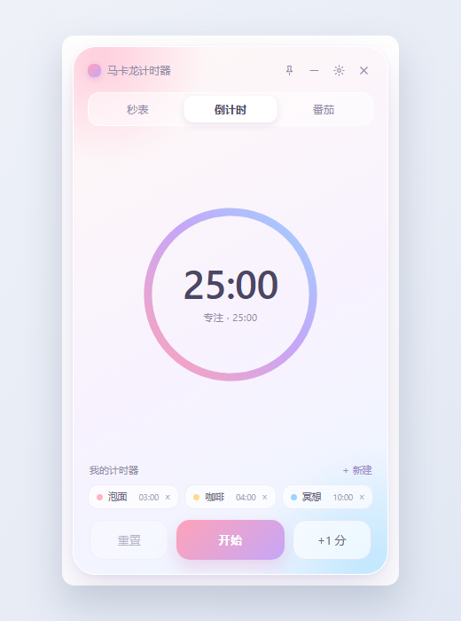
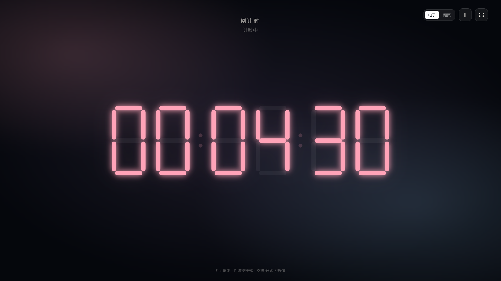
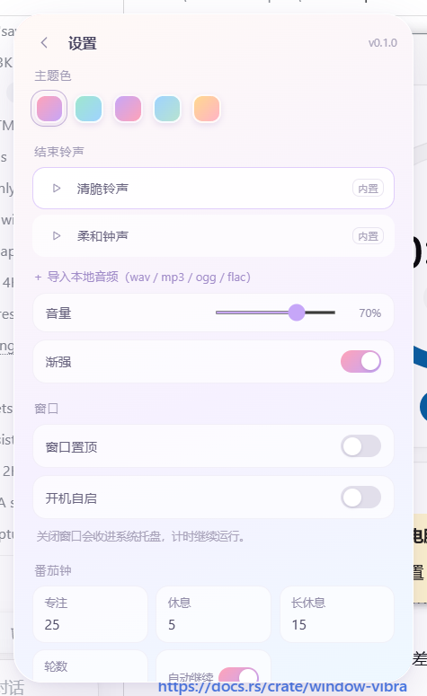

# 马卡龙计时器 MacaronTimer


一个没有传统 Windows 窗口的悬浮式计时器：无边框、圆角、马卡龙配色、常驻托盘。
秒表 / 倒计时 / 番茄钟三合一，支持提前创建多个计时器、自定义结束铃声。



## 下载

从 [Releases](https://github.com/hsn951/Timer/releases) 下载（当前 **v0.2.0**）：

- `MacaronTimer_0.2.0_x64-setup.exe` — NSIS 安装包（按用户安装，无需管理员）
- `MacaronTimer-v0.2.0-portable.zip` — 便携版，解压双击即用

变更记录见 [CHANGELOG.md](CHANGELOG.md)。

## 功能

- **秒表**：开始 / 暂停 / 重置 / 计次，显示到百分秒，计次列表滚动查看
- **倒计时**：时/分/秒任意设定，+1 分钟，环形进度，结束响铃 + 系统通知
- **番茄钟**：专注 / 小憩 / 长休息自动循环，轮次圆点，参数可调
- **我的计时器**：提前建好常用计时器（泡面 3 分钟、咖啡 4 分钟…），点一下直接开始；同一时间只跑一个
- **自定义铃声**：导入本地 wav / mp3 / ogg / flac，试听、调音量、渐强淡入，导入即校验，坏文件当场拒绝
- **窗口**：无边框圆角、可拖动、置顶、迷你模式（300×96 只剩数字）、关闭到托盘继续计时
- **全屏沉浸**：一键全屏（`F`），两种时钟皮肤——七段电子管 / 翻页牌；`Esc` 退出，鼠标静止自动隐藏控件
- **托盘菜单**：显示/隐藏、开始/暂停、静音、退出
- **快捷键**：`Space` 开始暂停、`R` 重置、`L` 计次、`1/2/3` 切页、`Esc` 返回；
  全局 `Ctrl+Alt+Space` 呼出窗口 / 开始暂停（窗口收进托盘时优先呼出），`Ctrl+Alt+T`、`Ctrl+Alt+H` 也可呼出（若被其他软件占用则自动失效）
- **设置**：主题色（5 套马卡龙）、音量、渐强、置顶、开机自启、番茄参数
- **健壮性**：单实例、配置原子写入、休眠唤醒后自动补偿时间、崩溃后恢复为暂停态

## 技术栈

| 层 | 技术 |
|---|---|
| 外壳 | Tauri 2（Rust 1.77+ / MSVC） |
| 前端 | 原生 ES Module + Vite，零 UI 框架，产物 ~16 KB |
| 计时内核 | Rust 单调时钟 + 目标时刻计算（不累加），50 ms tick |
| 音频 | rodio + symphonia，独立音频线程（cpal 的 Stream 非 Send） |
| 存储 | `%APPDATA%\com.macaron.timer\` 下的 JSON（tmp + rename 原子写） |

## 目录

```
timer/
├─ index.html            # 单页结构
├─ src/                  # 前端：styles.css / main.js / api.js（含浏览器预览 mock）
├─ src-tauri/            # Rust 后端
│  ├─ src/lib.rs         # 启动、状态、tick 线程、托盘/快捷键注册
│  ├─ src/engine.rs      # 计时状态机
│  ├─ src/commands.rs    # IPC 命令
│  ├─ src/audio.rs       # 音频线程 + 内置铃声合成
│  ├─ src/tray.rs        # 托盘
│  └─ src/store.rs       # 设置/预设/铃声持久化
├─ scripts/              # 图标生成脚本
└─ docs/screenshots/     # 界面截图
```

## 构建

前置：Rust（stable-msvc）+ Visual Studio Build Tools（C++ 工作负载）+ Node 20+。

```powershell
# 1. 装前端依赖
pnpm install        # 或 npm install

# 2. 构建前端
pnpm build          # 产物在 dist/

# 3. 编译并运行
cargo build --release --manifest-path src-tauri/Cargo.toml
.\src-tauri\target\release\macaron-timer.exe
```

也可以直接用 `scripts\build.ps1` / `scripts\run.ps1`（会自动把 Rust 目录加进 PATH）。

开发调试用 `scripts\dev.ps1`：Vite HMR + Tauri debug 窗口，改前端不用重新编译 Rust。

> 没有安装 `@tauri-apps/cli` 也能构建：Tauri 在编译期通过 `frontendDist` 把 `dist/` 嵌进 exe。
> 需要生成 NSIS 安装包时再执行 `cargo install tauri-cli` 然后 `cargo tauri build`。

## 版本与迭代

- 语义化版本（SemVer），`package.json`、`Cargo.toml`、`tauri.conf.json` 三处版本号必须一致，用 `scripts/bump-version.ps1 0.2.0` 一次更新
- `main` 始终保持可构建；推送 `v*` 标签会触发 GitHub Actions 在 `windows-latest` 上构建 NSIS 安装包并创建 Draft Release
- 发布流程、代码约定见 [CONTRIBUTING.md](CONTRIBUTING.md)

## 浏览器预览

`src/api.js` 在没有 `window.__TAURI__` 时会启用一套本地 mock，所以可以纯前端调 UI：

```powershell
pnpm dev
# http://127.0.0.1:1420/?mock=stopwatch
# ?mock=pomodoro / ?view=settings / ?view=preset
```

## 直接运行

`release/MacaronTimer-0.1.0-portable.zip` 解压后双击 `MacaronTimer.exe`，无需安装。
首次运行会在 `%APPDATA%\com.macaron.timer\` 生成配置与两个内置铃声。

## 全屏沉浸




## 实机截图（125% DPI）




## 数据与卸载

- 配置：`%APPDATA%\com.macaron.timer\settings.json`
- 预设：`presets.json`
- 铃声：`sounds\`（首次运行自动生成两个内置铃声）
- 卸载后数据保留，删除上述目录即可彻底清理。

## 已知边界

- 仅支持 Windows 10 1809+ / Windows 11（WebView2）
- 同时只运行一个计时器（设计如此）；常用时长请存成"我的计时器"
- 铃声格式限 wav / mp3 / ogg / flac，m4a 需先转码
- 内存：主进程约 25 MB，加上 WebView2 子进程合计约 150–250 MB；安装包约 5–8 MB
- 全局快捷键可能被输入法/截图工具抢先注册；此时仍可用托盘菜单或再双击一次 exe 唤醒窗口
- 关闭窗口 = 收进托盘，不会退出；退出请用托盘菜单的「退出」
